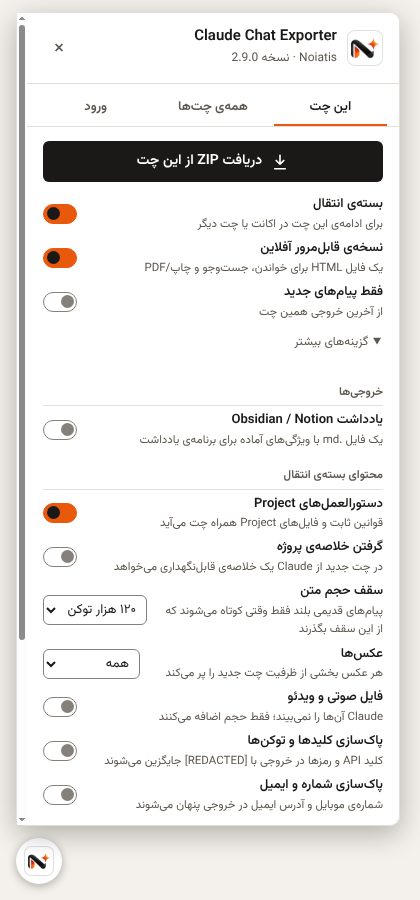
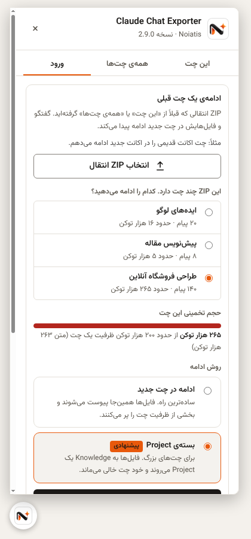

<div dir="rtl" align="right">

<h1>📦 Claude Chat Exporter</h1>

**ساخته‌شده توسط [نویاتیس](https://noiatis.ir/)** · [English 🇬🇧](README.md)

افزونه‌ی غیررسمی **کروم و فایرفاکس** برای ذخیره‌ی چت‌های [claude.ai](https://claude.ai) و انتقال آن‌ها به اکانت دیگر.

🔒 همه‌چیز روی خود مرورگر شما انجام می‌شود. سروری در کار نیست و چیزی جایی فرستاده نمی‌شود.

---

## ✨ قابلیت‌ها

| | قابلیت | توضیح |
|---|---|---|
| 💬 | **یک چت، همه‌ی چت‌ها یا یک Project** | برای هر چت یک پوشه و یک `index.html` قابل‌جست‌وجو. پشتیبان‌های بزرگ به چند ZIP تقسیم می‌شوند. |
| 🌐 | **مرورگر آفلاین** (`viewer.html`) | جست‌وجو، حالت تیره، چاپ یا ذخیره به‌صورت PDF. |
| 📝 | **Obsidian و Notion** | فایل `.md` همراه با frontmatter. |
| 📂 | **زیپ پوشه‌ی پروژه** | در زبانه‌ی «ورود» یک پوشه انتخاب می‌کنید؛ افزونه فشرده‌اش می‌کند، محتوا را بازبینی می‌کند و به کادر پیام پیوست می‌کند. اگر بخواهید پوشه‌هایی مثل `node_modules` کنار گذاشته می‌شوند. بالای ۳۰ مگابایت چند ZIP مستقل می‌سازد. |
| 🔁 | **بسته‌ی انتقال** | ادامه‌ی کار در اکانت دیگر: فایل‌های متن، یک پیام آماده و دکمه‌ی «ورود» که پیوست‌ها را می‌چیند. در صورت تمایل از Claude «خلاصه‌ی پروژه» هم می‌خواهد. تخمین حجم، متن فارسی و عکس‌ها و فایل‌ها را حساب می‌کند و فقط وقتی از سقف بگذرد، خطوط ابزار و پاسخ‌های بسیار بلند و قدیمی کوتاه می‌شوند. برای چت‌های بزرگ، «ورود» به‌جای پر کردن چت، «بسته‌ی Project» (فایل‌ها برای Knowledge یک Project) را پیشنهاد می‌دهد و از ZIP چندچتی می‌توانید یک چت را انتخاب کنید. |
| ➕ | **خروجی افزایشی** | فقط پیام‌های بعد از آخرین خروجی همان چت. |
| ⏰ | **پشتیبان زمان‌بندی‌شده** | روزانه یا هفتگی، فقط برای چت‌های تازه یا تغییرکرده. |
| 🧩 | **Artifactها و فایل‌ها** | همه‌ی نسخه‌های Artifact، فایل‌هایی که Claude ساخته (با ویرایش‌های بعدی)، فایل‌های آپلودشده و دستورالعمل Project. |
| 🛡️ | **پاک‌سازی اطلاعات حساس** | حذف اختیاری کلیدها و توکن‌ها، و جداگانه شماره‌ی موبایل و ایمیل. گزینه‌هایی که انتخاب کرده‌اید یادشان می‌ماند. |
| 🎛️ | **گزینه‌های ریزتر** | گنجاندن «تفکر» Claude و جزئیات ابزارها و خروجی همه‌ی شاخه‌های ویرایش/بازتولید (پیش‌فرض همه خاموش)، انتخاب عکس‌ها (همه / ۱۰ عکس آخر / هیچ‌کدام) و صوت و ویدئو برای بسته‌ی انتقال، و سقف توکن آن (۶۰ هزار، ۱۲۰ هزار، ۱۷۰ هزار یا بدون سقف). |

---

## 📸 تصاویر

| این چت | ورود |
|---|---|
|  |  |

---

## 🚀 نصب

- 🏪 **فروشگاه:** به‌زودی
- 📥 **دستی:** از بخش [Releases](../../releases) فایل zip مرورگرتان را بگیرید.
  - 🟢 **کروم:** از حالت فشرده درآورید ← `chrome://extensions` ← روشن کردن Developer mode ← Load unpacked
  - 🦊 **فایرفاکس:** `about:debugging#/runtime/this-firefox` ← Load Temporary Add-on ← انتخاب `manifest.json`

---

## 🖱️ استفاده

یک **دکمه‌ی گرد نویاتیس** گوشه‌ی پایین-چپ صفحه‌ی claude.ai ظاهر می‌شود. سه زبانه دارد:

1. 💬 **این چت:** خروجی چتی که باز است
2. 🗂️ **همه‌ی چت‌ها:** پشتیبان‌گیری گروهی
3. 📤 **ورود:** انتخاب ZIP انتقال (و چت موردنظر، اگر چند چت دارد)، بعد ادامه در چت جدید یا ساخت بسته‌ی Project. یا فرستادن پوشه‌ی پروژه به Claude

⚙️ تنظیمات پشتیبان خودکار در پاپ‌آپ آیکن افزونه است.

---

## 🛠️ توسعه

```bash
npm install
npm test              # تست منطق اصلی
npm run build         # پوشه‌ها و zip کروم و فایرفاکس در dist/
npm run lint:firefox
```

- 📐 قواعد ظاهر و دلیل هر انتخاب: [DESIGN.md](DESIGN.md)
- 🔤 فونت: وزیرمتن (Vazirmatn) داخل `src/fonts/` با مجوز آزاد SIL OFL. متن مجوز کنار فایل‌ها در `OFL.txt` است و باید همان‌جا بماند.

📚 **مستندات بیشتر:** [حریم خصوصی](PRIVACY.md) · [متن فروشگاه‌ها](docs/STORE_LISTING.md)

---

## ⚠️ توجه

وابسته به Anthropic نیست و تأیید آن را ندارد. از آدرس‌های داخلی و مستندنشده‌ی claude.ai استفاده می‌کند که ممکن است بی‌خبر عوض شوند. مجوز: [MIT](LICENSE).

</div>