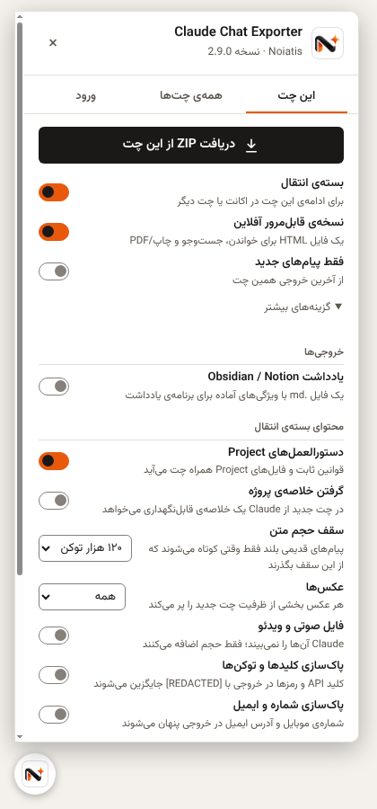
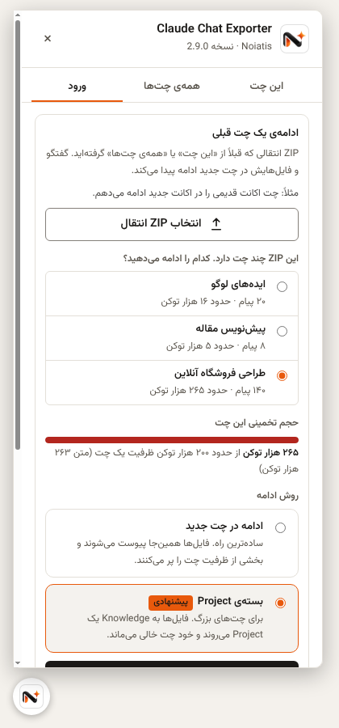

# 📦 Claude Chat Exporter

**By [Noiatis](https://noiatis.ir/)** · [فارسی 🇮🇷](README.fa.md)

Unofficial browser extension for **Chrome and Firefox** to export your [claude.ai](https://claude.ai) chats and move them between accounts.

🔒 Everything runs in your own browser. No servers, and nothing is sent anywhere.

[](LICENSE)


---

## ✨ Features

| | Feature | Details |
|---|---|---|
| 💬 | **One chat, all chats, or a Project** | A folder per chat plus a searchable `index.html`. Big backups are split into several ZIPs. |
| 🌐 | **Offline reader** (`viewer.html`) | Search, dark mode, print or save as PDF. |
| 📝 | **Obsidian / Notion** | A `<title>.md` file with frontmatter. |
| 🔁 | **Transfer pack** | Continue in another Claude account: context files, a ready-to-send handoff message and a one-click Import. Can optionally ask Claude for a reusable "project brief". The size estimate counts Persian text, images and files, and old tool lines or very long old replies are shortened only when the cap is exceeded. For big chats, Import recommends a **Project pack** (files for a Project's Knowledge) instead of filling a chat, and a multi-chat ZIP lets you pick which chat to continue. |
| ➕ | **Incremental export** | Only the messages after your last export of that chat. |
| ⏰ | **Scheduled backup** | Daily or weekly, only for new or changed chats. |
| 📂 | **Send a project folder to Claude** | In the Import tab, pick a folder: it is zipped, checked and attached to the chat box. Optionally skips rebuildable folders like `node_modules`. Above 30 MB it makes several independent ZIPs. |
| 🧩 | **Artifacts and files** | Every artifact version, files Claude created (with later edits applied), uploads and Project instructions. |
| 🛡️ | **Redaction** | Optionally strips API keys and tokens, and separately phone numbers and e-mail addresses. All your options are remembered. |
| 🎛️ | **Fine-grained options** | Include Claude's "thinking" and tool details, export all edit/retry branches (all off by default), choose images (all / last 10 / none) and audio/video for the transfer pack, and set its token budget (60k / 120k / 170k / no cap). |
| 🔤 | **Persian and English interface** | Switch the language with the button in the panel header or the toolbar popup. The offline reader, backup index and import guide follow the language you chose. Persian is the default. |

---

## 📸 Screenshots

| This chat | Import |
|---|---|
|  |  |

---

## 🚀 Install

- 🏪 **Store:** coming soon
- 📥 **Manual:** download the zip for your browser from [Releases](../../releases).
  - 🟢 **Chrome:** unzip → `chrome://extensions` → turn on Developer mode → Load unpacked
  - 🦊 **Firefox:** `about:debugging#/runtime/this-firefox` → Load Temporary Add-on → pick `manifest.json`

---

## 🖱️ Usage

A round **Noiatis button** appears at the bottom-left of claude.ai. It has three tabs:

1. 💬 **This chat:** export the chat you have open
2. 🗂️ **All chats:** bulk backup
3. 📤 **Import:** pick a transfer ZIP (and the chat, if it holds several), then continue in a new chat or build a Project pack. You can also send a project folder to Claude

⚙️ Scheduled-backup settings live in the toolbar icon's popup.

---

## 🛠️ Develop

```bash
npm install
npm test              # core logic tests
npm run build         # dist/chrome, dist/firefox + zips
npm run lint:firefox
```

- 🎨 Branding (name, site, logo): `src/brand.js`
- 📐 Design rules and the reasoning behind them: [DESIGN.md](DESIGN.md)
- 🔤 Font: Vazirmatn under the free SIL OFL licence. `OFL.txt` must stay next to the font files (see `src/fonts/README.md`).

📚 **More docs:** [Privacy](PRIVACY.md) · [Store texts](docs/STORE_LISTING.md)

---

## ⚠️ Disclaimer

Not affiliated with or endorsed by Anthropic. Uses claude.ai's internal, undocumented endpoints, which may change without notice. Released under the [MIT License](LICENSE).